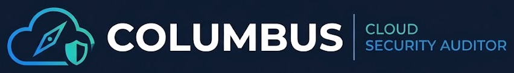
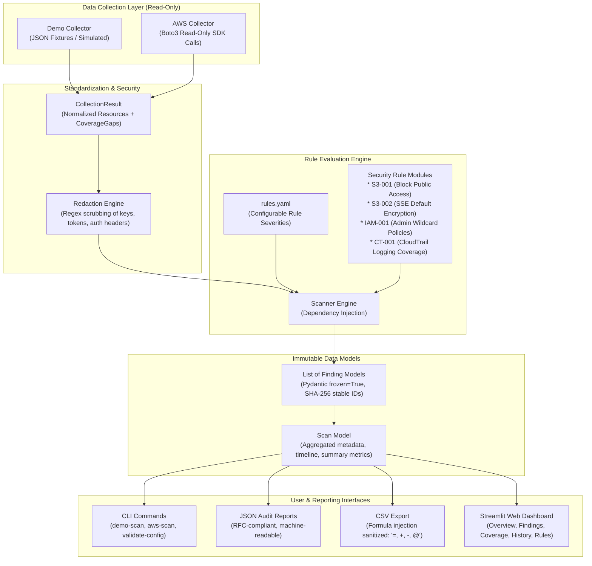

<p align="center">
  
</p>

<p align="center">
  <strong>A beginner-friendly, read-only AWS cloud configuration auditor written in Python.</strong>
</p>

> **Status: Complete (Phase 7 of 7).** Core audit foundation, demo scanner, security rules,
> JSON/CSV reporting, 5-page Streamlit web dashboard, read-only AWS boto3 collector, static
> typing (Mypy), Bandit AST security scanning, pip-audit CVE verification, and portfolio
> documentation are complete.

---

## Overview

Collumbus is a configuration auditor designed for students and security engineers to learn and perform cloud security audits safely. It evaluates AWS resources against industry security best practices (aligned with CIS AWS Foundations benchmarks) across Amazon S3, AWS IAM, and AWS CloudTrail.

It features a dual-source collector architecture:
1. **Demo Mode:** Runs completely offline against simulated multi-resource cloud environments without requiring an AWS account or incurring any cloud costs.
2. **AWS Mode:** Uses the official AWS Python SDK (`boto3`) to audit live cloud accounts strictly using read-only API calls.

---

## System Architecture



---

## Security Principles & Guarantees

1. **Read-Only / Zero-Modification:** Collumbus never creates, modifies, disables, or deletes any cloud resource. There is no auto-remediation.
2. **Fail-Closed on Visibility Gaps:** API errors, missing permissions (`AccessDenied`), and throttling are never treated as passes. They are reported as `ERROR` findings and `CoverageGap` records, marking the scan as incomplete (`is_complete = False`).
3. **Automated Secret Redaction:** Evidence dictionaries and logging streams automatically redact AWS access keys, secret keys, session tokens, and authorization headers.
4. **CSV Formula Injection Defense:** CSV exports sanitize cells starting with formula triggers (`=`, `+`, `-`, `@`, `\t`, `\r`) to prevent spreadsheet-based remote code execution (CWE-1236).
5. **No Hardcoded Credentials:** Authentication delegates to the standard AWS Boto3 credential chain (environment variables, `~/.aws/credentials`, IAM roles). Secrets are never accepted as command-line arguments or stored in config files.
6. **Deterministic Finding IDs:** Finding IDs are computed via SHA-256 over `[rule_id, account_id, region, resource_id]`, enabling accurate tracking of vulnerabilities across scans over time.

---

## Implemented Security Rules

| Rule ID | Title | Service | Description | CIS Benchmark |
|---|---|---|---|---|
| **S3-001** | S3 Block Public Access | Amazon S3 | Verifies all 4 Block Public Access settings are enabled on the bucket. | CIS 2.1.4 |
| **S3-002** | S3 Default Server-Side Encryption | Amazon S3 | Ensures bucket has default encryption enabled with an approved KMS/AES algorithm. | CIS 2.1.1 |
| **IAM-001** | IAM Administrator Wildcard Policy | AWS IAM | Detects customer-managed policies granting full administrative `*` on `*` resources. | CIS 1.16 |
| **CT-001** | CloudTrail Multi-Region Logging | AWS CloudTrail | Verifies trails are actively logging and every scanned region is covered. | CIS 3.1 |

---

## CLI Command Reference

All commands run via Windows PowerShell:

```powershell
# 1. Validate configuration files (config/rules.yaml)
python -m collumbus validate-config

# 2. Run an offline simulated demo scan
python -m collumbus demo-scan
python -m collumbus demo-scan --json scan.json --csv scan.csv

# 3. Run a read-only live AWS cloud scan
python -m collumbus aws-scan
python -m collumbus aws-scan --profile my-profile --regions us-east-1,us-west-2 --json live.json --csv live.csv

# 4. Export findings from a previous scan to CSV
python -m collumbus export-csv --input data/scans/scan_example.json --output report.csv --failures-only

# 5. Launch the interactive 5-page Streamlit web dashboard
python -m collumbus dashboard
```

---

## Development & Security Verification Suite

Collumbus is fortified by a multi-tier DevSecOps testing and static analysis pipeline:

```powershell
# Activate virtual environment
.\.venv\Scripts\Activate.ps1

# Run full test suite with coverage (143 tests, 94% coverage)
python -m pytest --cov=collumbus --cov-report=term-missing

# Static type checking across all source code and tests (0 errors)
mypy src tests

# AST security vulnerability analysis (0 issues)
bandit -r src

# Supply chain dependency vulnerability audit (0 CVEs)
pip-audit

# Code style, formatting, and linting
ruff check .
ruff format --check .
```

---

## Documentation

- **[Security Portfolio & Interview Guide](docs/PORTFOLIO_GUIDE.md):** Architectural deep-dive, technical interview Q&A, live demonstration script, and resume bullet points for Lance.
- **[Learning Guide](docs/LEARNING_GUIDE.md):** Educational concepts, security theory, and phase-by-phase notes for each component.
- **[CLAUDE.md](CLAUDE.md):** Project working agreement and development principles.

